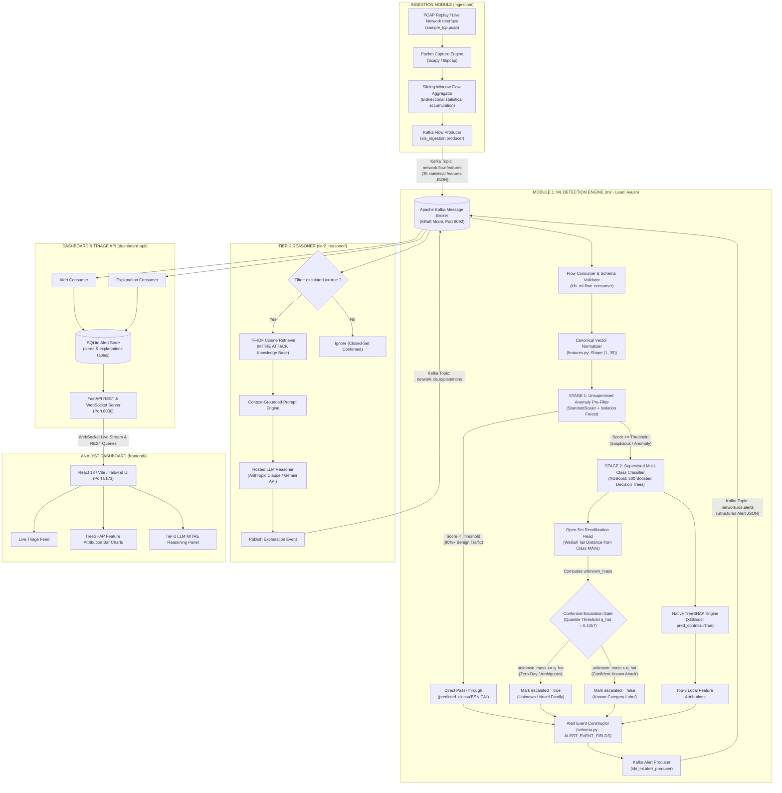

# System Architecture & Component Interaction

## 1. End-to-End System Architecture Diagram

---

## 2. Two-Minute Oral Architecture Pitch (Script for Sir)

> "Good morning, Sir. I am Ayush, representing Group 1, and I am responsible for **Module 1: The Machine Learning Detection Architecture and Complete Workflow**.
>
> "Our project addresses a fundamental vulnerability in classical network intrusion detection: classical models are closed-set, meaning when an unseen or zero-day attack hits the network, the model blindly forces it into a wrong category with false confidence.
>
> "To solve this in real time, we architected an asynchronous, event-driven pipeline running across four modular services connected via Apache Kafka:
>
> 1. **Data Ingestion:** Captures raw network traffic, aggregates packets into bidirectional flows, and computes 35 canonical statistical features (duration, packet rates, IAT statistics, and TCP flags).
> 2. **Stage 1 (Anomaly Pre-Filter):** Uses an unsupervised Isolation Forest. Because 99% of live network traffic is benign, Stage 1 drops normal traffic immediately, bypassing heavy computation and preserving microsecond latency.
> 3. **Stage 2 (Attack Classifier):** For flows flagged by Stage 1, a 300-tree XGBoost classifier predicts the specific attack family (such as DoS, PortScan, Brute Force, or Botnet).
> 4. **Open-Set Recalibration & Conformal Gate:** Instead of trusting closed-set softmax probabilities, we extract raw XGBoost margins and recalibrate them through an OpenMax Weibull-tail head. If the computed `unknown_mass` exceeds our mathematically proven Conformal Prediction threshold, the alert is automatically flagged as `escalated = true`.
> 5. **Local Explainability:** Every alert carries native TreeSHAP feature attributions, explaining the exact packet metrics driving the detection.
> 6. **Tier-2 LLM Reasoner & Triage UI:** Escalated zero-day alerts are consumed by our Tier-2 reasoner, which performs RAG retrieval against MITRE ATT&CK techniques and provides actionable natural-language guidance to the SOC analyst on our React dashboard.
>
> "Every component is containerized in Docker Compose, and all test benchmarks are empirically verified with zero data leakage. I am ready to demonstrate the code, the saved artifacts, and the experimental results."

---

## 3. Current Implementation vs. Intended Future Architecture

| Dimension | Current Verified Implementation | Intended Future Production Architecture |
|---|---|---|
| **Packet Capture** | Replaying verified PCAP files (`sample_tcp.pcap`) into Kafka | Live promiscuous packet capture using kernel-bypass (DPDK / eBPF / AF_XDP) |
| **Kafka Clustering** | Single-broker KRaft Kafka container | Multi-broker distributed Kafka cluster with partition replication factor $\ge 3$ |
| **Tier-1 Batching** | Single-flow sequential scoring (53.8 flows/s) | Micro-batched vector scoring (achieving >7,000 flows/s as benchmarked) |
| **Escalation Reasoner** | Hosted LLM API (Anthropic Claude / Gemini) with TF-IDF RAG | Local quantized LLM (e.g., Llama-3-8B-Instruct via vLLM) with vector DB (Qdrant) |
| **Online Adaptation** | Opt-in Adaptive Conformal Inference (ACI) with triage audit | Closed-loop automated feedback updating $\alpha_t$ directly from verified analyst triage |
| **Storage Engine** | SQLite database with auto-migrating schema | Distributed PostgreSQL / TimescaleDB with partitioned time-series tables |
